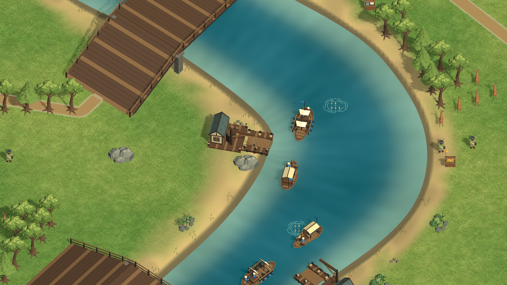

# 项目交接

这是 Unity 即时战略游戏源码项目。GitHub 的 `main` 已合入 `codex/land-rts-completion` 开发分支；项目仍是开发候选，不是经过完整发布验收的商业成品。

## 下载和运行

1. 克隆仓库，用 Unity Hub 打开项目目录，选择 Unity **6000.6.3f1**。
2. 打开 `Assets/Frontier/Scenes/FrontierSkirmish.unity` 并在编辑器运行；源码和项目设置在仓库中，Unity 包管理器可能需要网络获取依赖。
3. `Builds/`、`Library/`、`Logs/` 和用户设置不纳入 Git。已有[私有云盘客户端](https://drive.google.com/drive/folders/135YyVrETv164RbU0spprFQ0Rh-eogfnV)中的 Preview91 早于 085/087/089 改动，不能当作当前源码的发布包。当前源码曾另建本地开发构建，但尚未完成原生完整试玩与发布验证。

## 游戏素材在哪里

- `Assets/Frontier/Resources/Meadow085.bytes` 是草地 PNG 原始字节，随 Git 保存；`SourceAssets/Characters/Infantry024/FrontierInfantry.blend` 和游戏使用的 FBX、字体、shader 也在仓库。
- 大部分人物、建筑、船只、材质与特效由仓库中的 C# 和 shader 在游戏内生成，不一定对应单独 PNG 或 Blender 文件。草地来源记录见[素材来源](Art-085-Asset-Provenance.json)，第三方材料见[素材许可](Asset-Licenses.md)。
- [Showcase](Showcase/) 保存一段法国对奥斯曼视频及两张原始画面。它们是演示资料，不是游戏运行所需资源；其余历史截图、录像、构建包和运行输出分布在仓库证据目录、本地输出或私有云盘，不应假设全部包含在 Git 中。

[法国对奥斯曼：24 秒指挥演示](Showcase/france-ottoman-gameplay.mp4)是受控生成兵力、脚本下达真实游戏命令的静音片段，不是鼠标实操或完整对局。[截图](Showcase/france-ottoman-frame.png)和[文件摘要](Showcase/manifest.json)记录来源和内容。

## 当前验收与已知限制

085 兵种、建筑、船只和河流画面、087 道路与开火反馈，以及 089 中立盟友、AI、道路软肩和迷雾改动已进入开发分支。089 的 50 项 EditMode 和 10 项 PlayMode 是同一源码版本的定向检查，见[089 说明](Neutral-089.md)。此前 237 项检查和 Preview91 属于更早源码，不能用来证明后续改动的完整回归。

当前版的完整回归、正常开局到结束的原生试玩、长期性能与签名公证发布尚未验收；用户要求的 400 人验收已暂缓。普通旧存档的复制仅覆盖已验证的 0.25.0 规则；更早存档、旧场景、引导存档和录像需要各自原版本或构建。法国与奥斯曼录像展示命令被接受，不证明目标已被消灭或整局 AI、寻路均已验收。更多限制见[已知限制](Known-Issues.md)。
